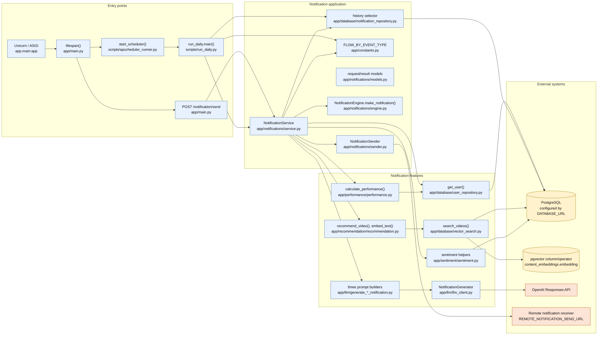
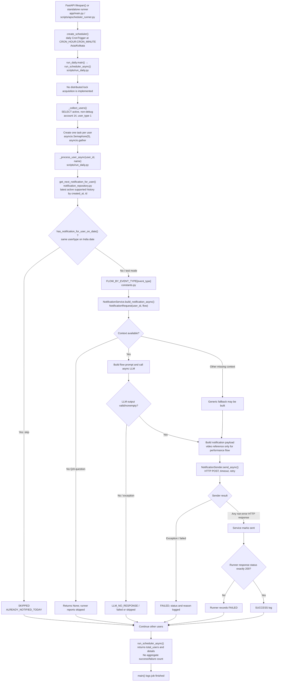
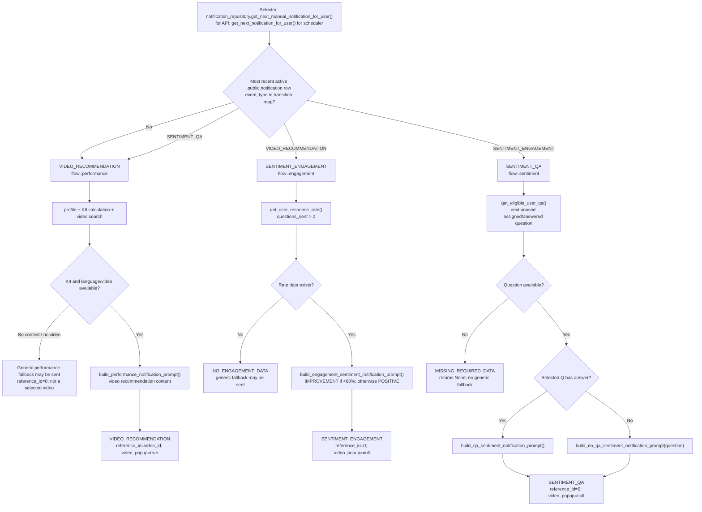
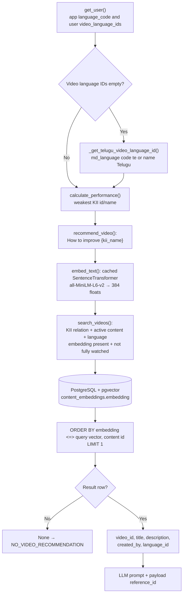
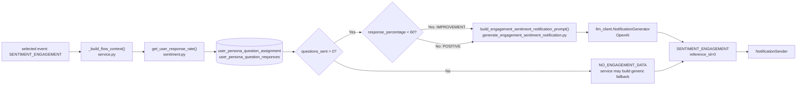
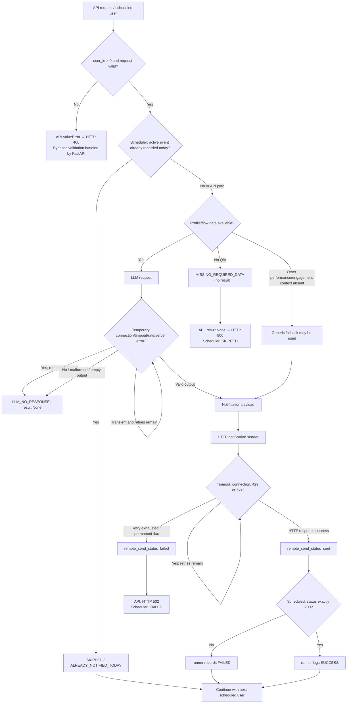
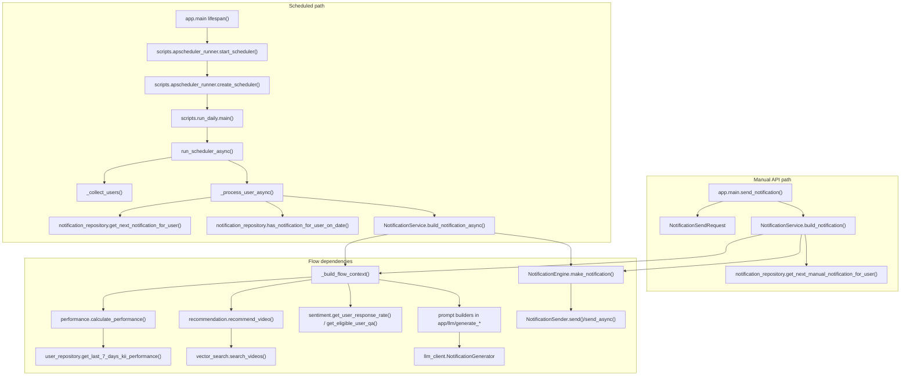
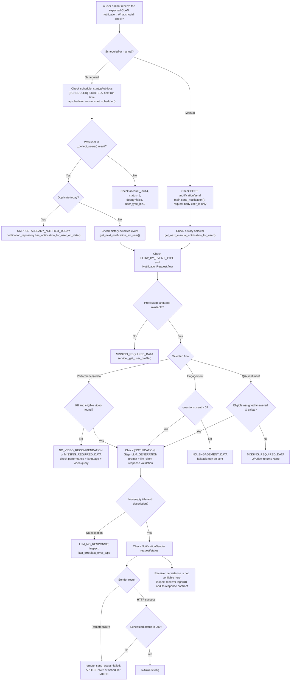

# CLAN Notification System Architecture

This document describes the repository's current implementation. A solid Mermaid
arrow means a call or data flow verified in source. Dashed arrows indicate
configuration, optional behavior, or a relationship that cannot be verified
from this repository.

## System purpose and important constraints

The FastAPI application exposes notification read endpoints and a send endpoint.
It also starts an in-process APScheduler job during application startup. The
scheduled runner selects active users and sends at most one selected notification
type per user per day, subject to the history check. The current notification
types cycle through `VIDEO_RECOMMENDATION`, `SENTIMENT_ENGAGEMENT`, and
`SENTIMENT_QA`.

The app sends a request to the configured external notification URL. There is
no receiver implementation in this repository, so the receiver's persistence
behavior and its response contract are **unknown**. The app does not insert into
`public.notification` in the active send paths. An insertion helper exists, but
it is not called from the API or scheduled flow. Q/A sentiment sends do write to
the separate `public.sentiment_notification_history` table after remote send
success.

The current scheduler is daily at a configured hour/minute; it does not configure
weekday restrictions. No Monday/Wednesday/Friday schedule or `REMINDER` type is
implemented in this repository. Do not infer that production uses only one
instance: deployment topology is not included.

## A. System architecture overview



### Entry points and boundaries

- **App startup and API:** [`app/main.py`](../app/main.py) initializes FastAPI,
  validates configuration, starts/stops APScheduler, and defines the HTTP routes.
- **Scheduled job:** [`scripts/apscheduler_runner.py`](../scripts/apscheduler_runner.py)
  schedules [`scripts/run_daily.py`](../scripts/run_daily.py) once per day at
  configured hour/minute in `Asia/Kolkata`.
- **Manual API send:** `POST /notification/send` accepts only
  `NotificationSendRequest(user_id)`; it does not accept a flow override.
- **Persistence boundary:** the receiver is outside this repository. The
  active API and scheduled send paths do not call
  `notification_repository.insert_notification()`.
- **No internal scheduler DB lock:** the runner has a semaphore limiting
  in-process user concurrency to five. APScheduler has `max_instances=1` for
  this scheduler instance. There is no distributed/advisory database lock in
  the active scheduler code. The `threading.Lock` in `apscheduler_runner.py`
  guards local scheduler start/shutdown state only.

## B. Scheduled notification lifecycle



### Scheduled inputs, outputs, and failure behavior

1. `start_scheduler()` calls `create_scheduler()` once per process. It uses
   `CRON_START_DATE`, `CRON_HOUR`, `CRON_MINUTE`, `Asia/Kolkata`,
   `max_instances=1`, `coalesce=True`, and `misfire_grace_time=3600`.
2. `_collect_users()` selects `public."user"` rows matching
   `account_id = 14`, `status = 1`, `debug = false`, `user_type_id = 1`.
3. `_process_user_async()` determines the event from the user's active
   notification history. `SCHEDULER_TEST_MODE` bypasses only the daily
   duplicate check; it does **not** disable HTTP sending.
4. A database exception or per-user exception is caught in the per-user
   coroutine, logged, and returned as a failed result so other gathered tasks
   can proceed.
5. The sender retries transient HTTP/connection errors. The service reports
   `sent` for any HTTP success response; the runner independently treats only
   status 200 as successful.
6. The job returns `{"total_users": ..., "details": [...]}`. There is no
   aggregate summary count in the current returned object.

## C. Manual API notification lifecycle

```mermaid
sequenceDiagram
    actor Client
    participant API as app/main.py
    participant Model as NotificationSendRequest<br/>app/notifications/models.py
    participant Service as NotificationService<br/>app/notifications/service.py
    participant Repo as notification_repository.py
    participant Features as performance / sentiment / recommendation
    participant LLM as llm_client.py → OpenAI
    participant Sender as NotificationSender<br/>app/notifications/sender.py
    participant Receiver as REMOTE_NOTIFICATION_SEND_URL

    Client->>API: POST /notification/send {"user_id": n}
    API->>Model: Validate body (extra fields forbidden)
    API->>Service: build_notification(request.user_id)
    Service->>Repo: get_next_manual_notification_for_user()
    Repo-->>Service: event_type from active history (or first video type)
    Service->>Features: _build_flow_context(user_id, selected flow)
    Features-->>Service: profile and flow-specific context, or skip
    Service->>LLM: sync generate(prompt, user_id, notification_type)
    LLM->>LLM: retry temporary errors; validate JSON fields
    LLM-->>Service: title, description, action
    Service->>Service: validate nonempty title/description
    Service->>Sender: send(notification fields)
    Sender->>Receiver: POST JSON list with one notification
    Receiver-->>Sender: HTTP response (persistence contract unknown)
    Sender-->>Service: status_code, parsed/fallback response body
    Service-->>API: NotificationProcessingResult
    API-->>Client: success, user_id, notification
```

**Manual API specifics:** `NotificationSendRequest` permits `user_id` only and
forbids extra fields. The service is called with the integer user ID; when
`flow` is omitted, it reads notification history and maps the event to a flow.
API exceptions are returned as HTTP 400 for `ValueError`, HTTP 502 for remote
send failure/skipped sender, and HTTP 500 for generation returning `None` or
other exceptions. The GET endpoints call service read methods only.

Unlike the scheduled path, the API path does **not** call
`has_notification_for_user_on_date()`. It can send on repeated manual calls.

## D. Notification type and flow decision tree



Flow-to-type mapping is also repeated directly in the synchronous and
asynchronous service methods. `FLOW_BY_EVENT_TYPE` is used by the runner and
service to map selected event names to flow names. The separate
`NEXT_NOTIFICATION_BY_EVENT_TYPE` defines the three-type cycle.

## E. Performance notification data flow

```mermaid
flowchart LR
    User["user_id from API or scheduler"] --> Context["_build_flow_context()<br/>app/notifications/service.py"]
    Context --> Profile["get_user()<br/>app/database/user_repository.py<br/>app language + video language ids"]
    Profile --> Calc["calculate_performance()<br/>app/performance/performance.py"]
    Calc --> Query["get_last_7_days_kii_performance()<br/>app/database/user_repository.py"]
    Query --> KiiDb[("key_input_indicators<br/>key_input_target<br/>kii_master")]
    KiiDb --> Formula["SUM kill_value over latest date - 6d .. latest date<br/>daily target = monthly target / 22 or master daily_target<br/>seven-day target = daily target × 7<br/>achievement = actual / target × 100"]
    Formula --> Weak["minimum performance_percentage<br/>among fixed IDs 117–121"]
    Weak --> Video["recommend_video()<br/>How to improve {kii_name}"]
    Video --> Embed["embed_text()<br/>SentenceTransformer all-MiniLM-L6-v2<br/>384 dimensions"]
    Embed --> Search["search_videos()<br/>app/database/vector_search.py"]
    Search --> VideoDb[("content, kii_content_relation,<br/>md_language, content_embeddings,<br/>user_watched_history_copy")]
    VideoDb --> Selected{"One matching video?"}
    Selected -- "No" --> Fallback["NO_VIDEO_RECOMMENDATION<br/>service may build generic fallback"]
    Selected -- "Yes" --> Prompt["build_performance_notification_prompt()<br/>app/llm/generate_performance_notification.py"]
    Prompt --> OpenAI["NotificationGenerator.generate()<br/>app/llm/llm_client.py → OpenAI"]
    OpenAI --> Valid["nonempty title and description"]
    Valid --> Payload["NotificationEngine.make_notification()<br/>VIDEO_RECOMMENDATION<br/>reference_id=selected video_id"]
    Payload --> Sender["NotificationSender.send()/send_async()"]
```



`calculate_performance()` calls `get_last_7_days_kii_performance()` from
`user_repository.py`. The second helper chain in `performance.py`—
`_get_performance_rows()` → `get_performance_details()` →
`get_weakest_performance()`—is a separate implementation and is not called by
`calculate_performance()`. It chooses seven distinct dates rather than a
seven-calendar-day interval.

No reminder content flow or separate reminder performance prompt is implemented.
Missing KII or video context can enter the service's generic performance
fallback; whether to send that fallback is current service behavior, not proof
that it is a video notification.

## F. Video recommendation data flow



**Language distinction:** the user's `app_language_code` is sent to the LLM.
`video_language_ids` are applied to video selection. If the IDs are empty, the
service explicitly falls back to the Telugu language ID; if that lookup fails,
it marks required data missing.

**Embedding caveat:** no ingestion/embedding-generation job was found in the
tracked scripts. Active recommendation generates only the query embedding.
Stored `content_embeddings` are read from PostgreSQL. `search_videos()` uses
the supplied `db_engine`; `query_points()` is a separate function that uses the
module-level engine and is not called by the active recommendation path.
`query_points()` returns `SearchResult` records and has additional latest
embedding/dimension filtering; it is not the active video-ranking query.

## G. Sentiment notification data flows

### Engagement: `SENTIMENT_ENGAGEMENT`



`get_user_response_rate()` calculates answered distinct questions divided by
assigned distinct questions, times 100. This is a question response-rate
notification, despite its `SENTIMENT_ENGAGEMENT` type name.

### Q/A: `SENTIMENT_QA`

```mermaid
flowchart LR
    Event["selected event: SENTIMENT_QA"] --> Service["_build_flow_context()<br/>service.py"]
    Service --> Eligible["get_eligible_user_qa()<br/>sentiment.py"]
    Eligible --> QaTables[("question_assignment,<br/>question responses/questions/answers,<br/>sentiment_notification_history")]
    QaTables --> Chosen{"Eligible question?"}
    Chosen -- "None" --> Skip["MISSING_REQUIRED_DATA<br/>return None; do not send"]
    Chosen -- "Selected" --> Prepare["prepare_user_qa(rows=eligible responses)"]
    Prepare --> Answer{"Selected question has answers?"}
    Answer -- "Yes" --> AnsweredPrompt["build_qa_sentiment_notification_prompt()"]
    Answer -- "No" --> NoAnswerPrompt["build_no_qa_sentiment_notification_prompt(question)"]
    AnsweredPrompt --> LLM["llm_client.NotificationGenerator<br/>OpenAI"]
    NoAnswerPrompt --> LLM
    LLM --> Valid["nonempty title and description"]
    Valid --> Payload["SENTIMENT_QA<br/>reference_id=0"]
    Payload --> Send["NotificationSender"]
    Send --> Sent{"Remote send succeeds?"}
    Sent -- "Yes" --> History["save_sentiment_notification_history()<br/>local INSERT/optional cycle reset"]
```



Eligible question selection considers answered questions and assigned
questions without active answers, checks sentiment history for used question
IDs, picks the earliest unused question, then resets to the earliest question
after a cycle is exhausted. Successful remote Q/A send is followed by local
sentiment-history persistence. This table is separate from
`public.notification`.

`get_next_sentiment_response()` and other sentiment helpers exist in
`sentiment.py`; not all have active service callers. Preserve sentiment code and
tests. See the file responsibility map for active/test-only references.

## H. Database and external-service interaction map

| Caller | Interaction | Read/write | Notes |
|---|---|---|---|
| `database/connection.py:create_engine` | PostgreSQL via `DATABASE_URL` | Connection setup | `pool_pre_ping=True`; schema and production permissions not included. |
| `run_daily.py:_collect_users` | `public."user"` | Read | Account/status/debug/user-type filters for scheduled users. |
| `user_repository.py:get_user` | user, expert_user, app-language and video-language tables | Read | Provides app language and video-language IDs. |
| `user_repository.py:get_last_7_days_kii_performance` | KII actuals, targets, master | Read | Fixed account and KII IDs; called by active performance calculation. |
| `notification_repository.py:get_next_manual_notification_for_user` | `public.notification` | Read | History-based event selector, used by manual API and helper selector. |
| `notification_repository.py:get_next_notification_for_user` | delegates to previous selector | Read | Used by scheduled runner; `as_of_date` is ignored by selector. |
| `notification_repository.py:has_notification_for_user_on_date` | `public.notification` | Read | Per-user/event India-date duplicate check. |
| `notification_repository.py:insert_notification` | `public.notification` | Write, helper only | Reached by `schedule_next_notification_for_user()`; no active send-path caller found. Do not infer receiver persistence from this helper. |
| `sentiment.py:get_user_response_rate` | assignment and response tables | Read | Counts distinct question IDs. |
| `sentiment.py:get_eligible_user_qa` | question, assignment, responses, answers, sentiment history | Read | Selects next unused assigned/answered question. |
| `sentiment.py:save_sentiment_notification_history` | `sentiment_notification_history` | Write | Called after successful Q/A remote send; may deactivate prior cycle history. |
| `vector_search.py:search_videos` | content relations, content, language, embeddings, watched history | Read | Uses PostgreSQL pgvector `<=>`; one row selected. |
| `vector_search.py:query_points` | latest content embeddings and related metadata | Read | Separate/no active caller found; uses module-level engine. |
| `llm_client.py:NotificationGenerator` | OpenAI Responses API | External request | Sync and async implementations; model/key from config. |
| `notifications/sender.py:send` | `REMOTE_NOTIFICATION_SEND_URL` via `requests.post` | External request | Sync API path; timeout and retry configured. |
| `notifications/sender.py:send_async` | same URL via `httpx.AsyncClient.post` | External request | Async scheduler path; timeout and retry configured. |

The receiver implementation is absent. It is **unknown** whether a successful
HTTP response proves durable persistence, whether its database is the one
queried here, or whether it supports idempotency.

## I. Error handling, retries, duplicate prevention



### Retry and observability details

- LLM sync/async retry: up to three retries after the initial request; backoffs
  are 1, 2, and 4 seconds. Temporary errors include OpenAI connection, timeout,
  rate-limit, internal server errors, and API status codes >=500.
- Sender sync/async retry: up to three retries after the initial request for
  connection errors, timeouts, HTTP 429, and HTTP >=500; same 1/2/4-second
  backoff. Other HTTP errors raise immediately.
- Sender accepts non-error HTTP status; response JSON is parsed but malformed
  JSON falls back to response text. The receiver response body is not validated
  for a persisted notification ID.
- Scheduler additionally requires status **200**, causing a discrepancy for
  other successful 2xx responses.
- Duplicate prevention is a history read before send, not an atomic claim.
  `SCHEDULER_TEST_MODE` bypasses only this check.
- User-level logs include statuses such as `SUCCESS`, `FAILED`, `SKIPPED`,
  `ALREADY_NOTIFIED_TODAY`, and reasons such as `LLM_NO_RESPONSE`,
  `NO_VIDEO_RECOMMENDATION`, and `MISSING_REQUIRED_DATA`.
- No code here detects notification opened/read state. The inactive local
  insertion helper initializes `notification_read=False`; it is not evidence
  that a remote notification is unread or persisted.
- No advisory/distributed lock acquisition or release exists in the active
  scheduled path. `max_instances=1` applies to one APScheduler instance only.

## J. Function-to-file dependency map



## Feature-to-file change guide

| Change or debugging task | Starting file | Responsible function | Downstream dependencies | Tests to run |
|---|---|---|---|---|
| Change API startup/routes | `app/main.py` | `lifespan`, route handlers | `config`, service, scheduler runner | `test_app_scheduler_lifespan.py`, `test_notification_api.py` |
| Change scheduled execution/time | `scripts/apscheduler_runner.py` | `load_schedule_config`, `create_scheduler` | `scripts/run_daily.py` | `test_apscheduler_runner.py` |
| Change user eligibility | `scripts/run_daily.py` | `_collect_users` | PostgreSQL `public."user"` | `test_retry_and_scheduler.py` (mocked; verify direct DB risk before full run) |
| Change notification type selection | `app/database/notification_repository.py`, `app/constants.py` | `get_next_manual_notification_for_user`, `get_next_notification_for_user` | `public.notification`, flow map | `test_notification_cycle.py`, `test_notification_api.py` |
| Change duplicate check | `app/database/notification_repository.py` | `has_notification_for_user_on_date` | `public.notification`, `Asia/Kolkata` | `test_notification_cycle.py`, scheduler tests |
| Change KII calculation | `app/database/user_repository.py`, `app/performance/performance.py` | `get_last_7_days_kii_performance`, `calculate_performance` | KII actual/target/master tables | `test_performance.py` (contains direct database tests; use isolated DB) |
| Change alternate KII helper chain | `app/performance/performance.py` | `_get_performance_rows`, `get_performance_details`, `get_weakest_performance` | KII tables | No direct helper test found; do not conflate with active calculator |
| Change video candidate ranking | `app/database/vector_search.py` | `search_videos` | PostgreSQL/pgvector, content and watch tables | `test_vector_search.py`, `test_recommendation.py` |
| Change active query embedding | `app/recommendation/recommendation.py` | `embed_text`, `recommend_video` | Sentence Transformers model | `test_recommendation.py` |
| Change video-language fallback | `app/notifications/service.py` | `_get_user_profile`, `_get_telugu_video_language_id`, `_build_flow_context` | user language joins, `md_language` | `test_notifications_service.py` (mocked cases) |
| Change performance prompt | `app/llm/generate_performance_notification.py` | `build_performance_notification_prompt` | `llm_client.NotificationGenerator` | `test_llm.py`, `test_notifications_service.py` |
| Change engagement sentiment | `app/sentiment/sentiment.py` | `get_user_response_rate` | assignment/response tables | `test_sentiment.py`, `test_notifications_service.py` |
| Change engagement prompt | `app/llm/generate_engagement_sentiment_notification.py` | `build_engagement_sentiment_notification_prompt` | `llm_client` | `test_llm.py` |
| Change Q/A sentiment selection/history | `app/sentiment/sentiment.py` | `get_eligible_user_qa`, `save_sentiment_notification_history` | Q/A tables and sentiment history | `test_sentiment.py`, `test_notifications_service.py` |
| Change Q/A prompt | `app/llm/generate_qa_sentiment_notification.py` | `build_qa_sentiment_notification_prompt`, `build_no_qa_sentiment_notification_prompt` | `llm_client` | `test_llm.py` |
| Change LLM model/key/timeout | `app/config.py` | `load_settings`, `validate_configuration` | `llm_client.py`, environment | `test_config.py`, `test_retry_and_scheduler.py` |
| Change LLM retries | `app/llm/llm_client.py` | `_generate_with_retry`, `_generate_with_retry_async` | OpenAI SDK | `test_retry_and_scheduler.py`, `test_llm.py` |
| Change notification payload schema | `app/notifications/models.py`, `app/notifications/engine.py` | `Notification`, `make_notification` | service and sender | `test_notification.py`, `test_notification_api.py` |
| Change external delivery URL/timeout/retries | `app/config.py`, `app/notifications/sender.py` | `load_settings`, `send`, `send_async` | external receiver | `test_retry_and_scheduler.py`, API tests |
| Change sender/request response behavior | `app/main.py` | `send_notification` | service result, HTTP status mapping | `test_notification_api.py` |
| Change DB connection | `app/database/connection.py` | module-level `engine` | SQLAlchemy/driver, `DATABASE_URL` | No live connection tests unless isolated database confirmed |
| Change scheduler logging/error status | `scripts/run_daily.py` | `_log_user_status`, `_classify_terminal_error`, `_process_user_async` | log handlers, result statuses | `test_retry_and_scheduler.py` |
| Debug an unexpected skip | `scripts/run_daily.py`, `app/notifications/service.py` | `_process_user_async`, `_build_flow_context` | duplicate history, profile, performance, video, sentiment | focused mocked service/scheduler tests |
| Debug empty/invalid LLM output | `app/llm/llm_client.py`, `app/notifications/service.py` | `NotificationGenerator.validate`, generation methods | prompt builders, OpenAI response | `test_llm.py`, service tests |
| Debug generated but undelivered notification | `app/notifications/sender.py`, `scripts/run_daily.py`, `app/main.py` | `send`/`send_async`, `_process_user_async`, `send_notification` | receiver response and status conversion | mocked sender/API tests; receiver persistence remains external |
| Debug wrong recipient/language | `app/database/user_repository.py`, `app/notifications/service.py` | `get_user`, `_get_user_profile`, `_build_flow_context` | app language and `user_language` rows | `test_user_repository.py`, `test_notifications_service.py` |

## Debugging decision tree



## Potential Issues — No Code Changes Made

1. **Requested weekday cadence is absent.** Current CronTrigger is daily at
   `CRON_HOUR`/`CRON_MINUTE`; it has no weekday restriction, and the event map
   includes sentiment types, not `REMINDER`.
2. **Success status is inconsistent.** Sender treats any non-error HTTP response
   as sent; scheduled runner accepts only 200.
3. **Receiver persistence cannot be confirmed.** There is no receiver code or
   idempotency contract in this repository.
4. **Duplicate prevention is not atomic across instances.** The history check
   is a read before send; per-instance APScheduler `max_instances=1` is not a
   distributed lock.
5. **Embedding settings do not control the active embedder.** Config supports
   provider/model variables, but active recommendation hardcodes
   `all-MiniLM-L6-v2`.
6. **Generic fallbacks can have type/semantics mismatch.** The service can
   produce a `VIDEO_RECOMMENDATION` fallback without a selected video and with
   `reference_id=0`.
7. **Tests may access the configured DB.** `tests/test_performance.py` has
   database-backed tests; `test_recommendation.py::test_user_language_id_maps_to_language_table`
   also queries through the configured SQLAlchemy engine. Run only against an
   isolated test DB. This documentation task did not run tests.
8. **Test coverage is out of sync in places.** The last observed full suite
   before this documentation task had 155 passing and 12 failing tests;
   scheduler tests expected locking/summary/logging behavior not present in the
   current runner, and a prompt test expected text absent from the prompt.
   These results are historical and were not re-run for this task.
9. **README accuracy:** the current README has been corrected for its API
   request example and test/embedding caveats, but does not describe all the
   operational ambiguities above.

## Validation and limits

- Source and test references were checked in the repository; no live database
  or remote endpoint was accessed for this documentation work.
- No tests were run because some tests query the `DATABASE_URL` engine directly
  and the configured database has not been verified as isolated.
- Mermaid source was reviewed for balanced fences, declared nodes, and
  consistent diagram syntax, but no Mermaid renderer/parser is configured in
  the repository; rendering was not independently verified.
- No evidence was found for embedding ingestion scripts, external receiver
  implementation, deployment replica count, or production environment values.
